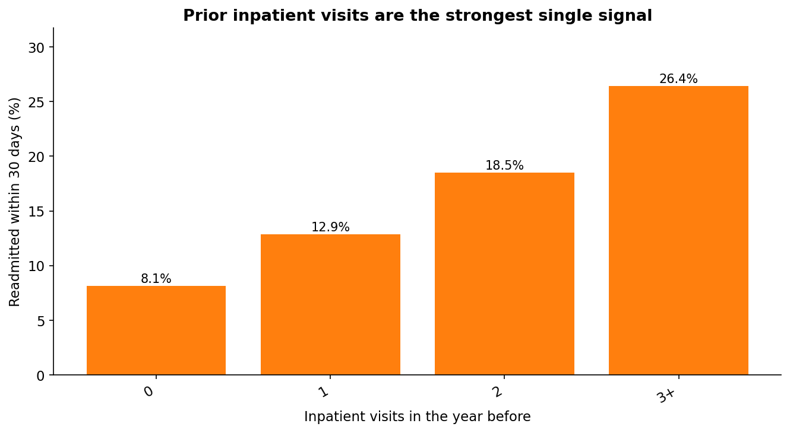
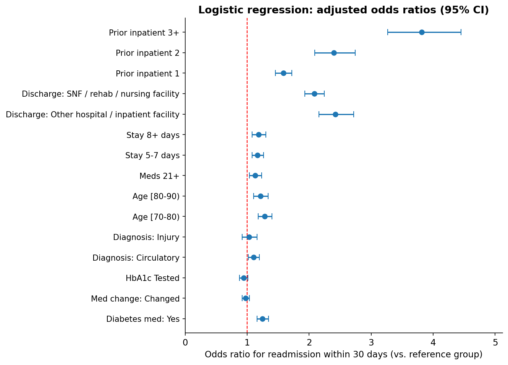

# Hospital Readmission Analysis

**Which patients come back within 30 days of discharge, and where should a hospital focus its interventions?**

Patients with 3+ inpatient visits in the previous year were readmitted at **26.5%**, more than triple the **8.1%** rate for patients with no prior inpatient visits — and that one small group is where a follow-up program buys the most avoided readmissions per patient.

## Key findings

- **Prior inpatient use is the strongest signal.** Readmission within 30 days rises steeply with inpatient visits in the previous year: 8.1% (0 visits, n = 61,790), 12.9% (1 visit), 18.5% (2 visits), and 26.5% (3+ visits, n = 896). Adjusted odds ratio for 3+ visits vs none: **3.82 (95% CI 3.27–4.45)**. Chi-square p < 0.001.
- **Discharge destination marks the risk.** Patients discharged home readmitted at **6.9%**, vs **14.8%** for skilled nursing / rehab facilities and **16.3%** for transfers to another hospital. The highest-risk combination in the data is 3+ prior inpatient visits with a SNF/rehab discharge: **31.3%** (52 of 166 patients).
- **Longer stays and heavier medication loads go with higher readmission.** Stays of 8+ days readmitted at 11.8% vs 7.2% for 1–2 day stays; 21+ medications at 10.5% vs 7.3% for 1–10. Both associations stay significant after adjustment (OR 1.19 and 1.13).
- **Two plausible levers do not hold up.** HbA1c-tested patients readmitted slightly less often (8.4% vs 9.1%), but the difference is not significant after adjustment (OR 0.94, p = 0.11). Gender shows no association at all (female 9.0% vs male 8.9%, p = 0.58), and race differences are small and not significant after adjustment.





An interactive-style static dashboard with KPI cards, segment tables, and a high-risk patient profile view is in [`dashboard/index.html`](dashboard/index.html). A spec for rebuilding it in Power BI or Tableau is in [`dashboard/dashboard_spec.md`](dashboard/dashboard_spec.md).

## Data source and size

- **Dataset:** UCI Diabetes 130-US Hospitals, 1999–2008 (Strack et al., 2014, "Impact of HbA1c Measurement on Hospital Readmission Rates", *BioMed Research International*).
- **Download:** [UCI Machine Learning Repository, dataset 296](https://archive.ics.uci.edu/dataset/296/diabetes-130-us-hospitals-for-years-1999-2008) (`dataset_diabetes.zip`, contains `diabetic_data.csv`).
- **Raw size:** 101,766 encounters from 130 US hospitals, 50 columns.
- **Analysis cohort:** **69,985 patients** (one encounter per patient — see Approach), of whom **6,284 (8.98%)** were readmitted within 30 days.
- The raw CSV is **not** committed to this repo (see `.gitignore`). Download it into `data/` to reproduce the analysis.

## Tools used

- **SQL** (DuckDB) for loading, cleaning, and all segment analysis — see `sql/`
- **Python** (pandas, statsmodels, SciPy) for statistical testing and the logistic regression — see `notebooks/01_readmission_analysis.ipynb`
- **Matplotlib** for charts (`images/`)

## Approach

1. **Load** the CSV into DuckDB (`scripts/load_clean.py`): tables `encounters_raw` (101,766 rows) and `encounters` (69,985 rows).
2. **Clean**, with every decision documented in the notebook and in `scripts/load_clean.py`: `?` placeholders treated as NULL; dropped `weight` (96.9% missing), `payer_code` (39.6% missing), and `medical_specialty` (49.1% missing); dropped 3 rows with unknown gender; excluded encounters ending in death (1,652), hospice (771), or "still patient" (3), since those patients cannot be readmitted; kept only the **first encounter per patient** (16,773 patients had repeats, max 40) so no patient is counted twice and the chi-square tests' independence assumption holds; grouped 700+ ICD-9 codes into 9 categories.
3. **Define the target:** `readmitted_30d` = 1 when `readmitted` is `<30`, else 0.
4. **Analyze in SQL** (`sql/01`–`sql/07`): readmission rate by age, race, gender, admission type/source, length of stay, medication count, prior utilization, HbA1c testing, medication changes, diagnosis group, and discharge destination, plus window-function rankings.
5. **Test statistically:** chi-square tests for categorical factors, Mann–Whitney U tests for numeric ones, and a logistic regression with odds ratios and 95% confidence intervals.
6. **Dashboard** the segments and the high-risk profiles (`dashboard/`).

## Recommendations

All framed as associations in this dataset, with the cost figures illustrative (see Limitations).

1. **Start with the 896 patients who had 3+ inpatient visits in the prior year (26.5% readmission rate).** Same-week follow-up calls and a post-discharge check-in for this group first. They are 1.3% of patients but 3.8% of all readmissions. At the AHRQ average readmission cost of $15,200 (see below), their 237 readmissions cost about **$3.6M**; cutting that group's readmissions by 20% would avoid ~47 readmissions, roughly **$714,000**.
2. **Coordinate the facility handoff.** SNF/rehab discharges readmit at 14.8% and other-hospital transfers at 16.3%, vs 6.9% for home. Confirm the receiving facility has the medication list and a follow-up appointment before the patient leaves.
3. **Flag long stays and heavy medication loads at discharge.** Stays of 8+ days (11.8%) and 21+ medications (10.5%) are easy to spot in the record; a medication review before discharge is the cheapest intervention in this list.
4. **Do not use HbA1c testing as a lever on this evidence.** The tested-vs-not-tested gap is small and vanishes after adjustment.
5. **Do not target by gender or race.** Neither holds up after adjustment. Age matters (70–90 readmit at 10–11%), but it is not actionable the way prior use is.

**Cost basis:** AHRQ HCUP Statistical Brief #278 (Weiss & Jiang, 2021) reports an average 30-day readmission cost of **$15,200** (2018 USD). Applied to this cohort's 6,284 readmissions, that is about **$95.5M** — illustrative only, since it is a national all-cause average, not a diabetes-specific cost.

## How to reproduce

```bash
git clone https://github.com/Saikrishna-469/hospital-readmission-analysis.git
cd hospital-readmission-analysis
pip install -r requirements.txt

# 1. Download the data (UCI dataset 296) and place diabetic_data.csv in data/
#    https://archive.ics.uci.edu/dataset/296/diabetes-130-us-hospitals-for-years-1999-2008

# 2. Load and clean into DuckDB (creates data/hospital_readmission.duckdb)
python scripts/load_clean.py

# 3. Run the SQL analysis (any DuckDB client, or the notebook)
#    sql/01_cohort_summary.sql ... sql/07_rankings.sql

# 4. Statistical tests, logistic regression, and charts
python scripts/analysis.py        # writes results/results.json and images/*.png

# 5. Rebuild the notebook and the HTML dashboard
python scripts/build_notebook.py
python scripts/build_dashboard.py
```

Then open `dashboard/index.html` in a browser and `notebooks/01_readmission_analysis.ipynb` in Jupyter.

## Repository structure

```
hospital-readmission-analysis/
├── README.md
├── requirements.txt
├── .gitignore
├── data/
│   ├── data_dictionary.md      # column definitions and ID mappings
│   ├── diabetic_data.csv       # raw data (download it, git-ignored)
│   └── hospital_readmission.duckdb   # built by scripts/load_clean.py (git-ignored)
├── sql/
│   ├── 01_cohort_summary.sql
│   ├── 02_readmission_by_demographics.sql
│   ├── 03_readmission_by_admission.sql
│   ├── 04_readmission_by_utilization.sql
│   ├── 05_readmission_by_clinical.sql
│   ├── 06_readmission_by_discharge.sql
│   └── 07_rankings.sql
├── notebooks/
│   └── 01_readmission_analysis.ipynb   # executed notebook: EDA, tests, model
├── scripts/
│   ├── load_clean.py           # CSV -> DuckDB, cleaning decisions
│   ├── analysis.py             # stats, logistic regression, charts
│   ├── build_notebook.py       # builds the executed notebook
│   └── build_dashboard.py      # builds dashboard/index.html
├── dashboard/
│   ├── index.html              # static dashboard (KPI cards, segments, high-risk profiles)
│   └── dashboard_spec.md       # how to rebuild it in Power BI / Tableau
├── images/                     # charts used in the README and dashboard
└── results/
    ├── results.json            # every number quoted in the README
    └── odds_ratios.csv         # full logistic regression output
```

## Limitations

- **Old, narrow data.** The dataset covers diabetic patients in 130 US hospitals from 1999–2008. Rates and patterns may not match a current general population.
- **Associations, not causes.** Discharge destination, medication changes, and prior visits are markers of how sick a patient already is. Nothing here proves an intervention would change the outcome.
- **Weak model.** The logistic regression explains little of the variation (McFadden pseudo-R² = 0.035). Clinical severity, social factors, and post-discharge care are not in this dataset, and they matter.
- **First-encounter choice.** Keeping one encounter per patient avoids double-counting but drops later encounters, so the 8.98% cohort rate is lower than the 11.16% `<30` share in the raw file — repeat patients readmit more often.
- **Cost figures are illustrative.** $15,200 is a 2018 national all-cause average from AHRQ HCUP, not the cost of a diabetes readmission in this cohort.
- **No medical claims.** Findings describe patterns in this dataset and are not clinical guidance for any individual patient.
